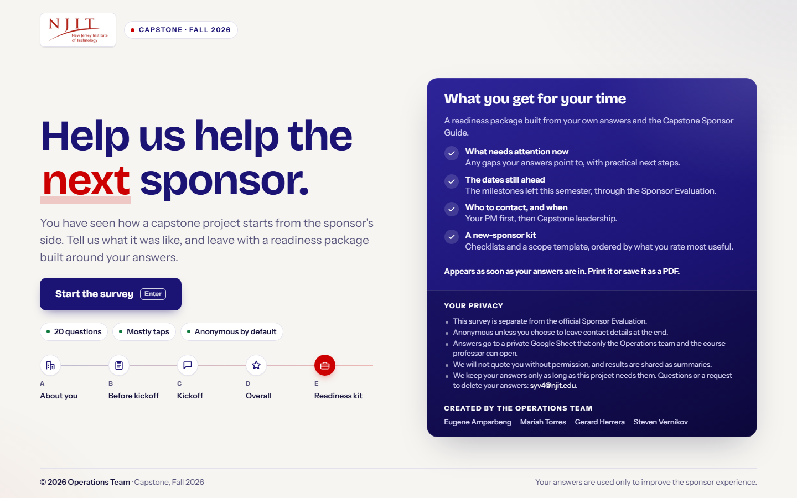
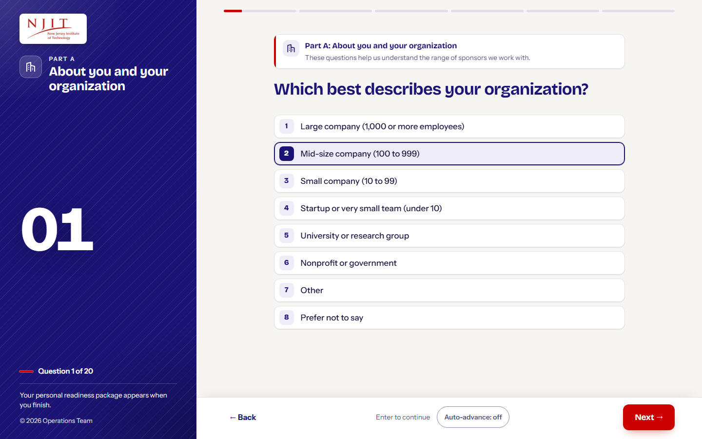
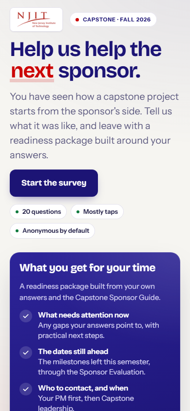

# Sponsor Experience Survey

**Help us help the next sponsor.** A 20-question survey for NJIT capstone project sponsors, built by the Fall 2026 Capstone Operations Team. It asks how prepared sponsors were before their student team began, and gives each one a personalised readiness package built from their own answers.

[](https://github.com/SlyGuy7/sponsor-survey/actions/workflows/test.yml)

**Take the survey:** https://slyguy7.github.io/sponsor-survey/

<picture>
  <source media="(prefers-color-scheme: dark)" srcset="docs/screenshots/welcome-dark.png">
  
</picture>

## Highlights

- **20 questions, mostly taps.** One question per screen, five parts, keyboard shortcuts on desktop and large tap targets on phones.
- **Something back for the sponsor.** After their answers are confirmed, sponsors get a readiness package: what needs attention now, the dates still ahead, who to contact, and a kit for new sponsors. It is built in their browser and can be printed or saved as a PDF.
- **Private by design.** Anonymous unless the sponsor leaves contact details. Answers go to a private Google Sheet, contact details are never saved in the browser, and the page loads nothing from third parties.
- **Never loses an answer.** The thank-you screen only appears once the answers are confirmed as received. If sending fails, the answers stay on the device with Retry and "Copy my answers".
- **Accessible.** Automated accessibility checks (axe) on every screen type in light and dark mode, real form controls for screen readers, and layout checks at 16 screen sizes.
- **Light and dark mode** that follow the device setting.

| A question | On a phone |
| --- | --- |
|  |  |

## Built by

The Fall 2026 NJIT YWCC Capstone Operations Team: **Eugene Amparbeng, Mariah Torres, Gerard Herrera and Steven Vernikov**.

---

# Maintainer guide

Everything below is for the team that runs and updates the survey.

## How it works

- A static site with plain HTML, CSS and JavaScript: no frameworks, no build step, no third-party scripts. Fonts are self-hosted.
- GitHub Pages publishes `main` at https://slyguy7.github.io/sponsor-survey/.
- **Backup copy:** Cloudflare Pages also publishes `main` on every push, for networks that block `github.io`. The `_redirects` file makes the `/sponsor-survey/` paths work there too. Both copies send answers to the same Apps Script, so it doesn't matter which one a sponsor uses.
- Answers are posted to a Google Apps Script web app (`apps-script/Code.gs`) that writes them to a private Google Sheet.
- The page only shows "Your answers are in" after the script replies `{"ok":true}`. Any other reply, a timeout or a blocked request shows "We could not confirm delivery", keeps the answers on the device and offers Retry and "Copy my answers".
- Progress is saved in the browser for 24 hours. Contact details (name, organization, email) are never saved to disk.

## Files

| Path | What it is |
| --- | --- |
| `index.html` | Page structure, metadata and the content security policy |
| `assets/style.css` | All styles. Colours, shadows and fonts are tokens at the top of `:root`, with dark-mode values just below |
| `assets/app.js` | Survey logic, submit, keyboard and history handling |
| `assets/survey.json` | Every question, option and setting. Edit this to change the survey |
| `assets/readiness.json`, `assets/readiness.js` | The readiness package: its wording and rules, and the code that builds it |
| `assets/fonts/` | Self-hosted WOFF2 fonts (Bricolage Grotesque, Instrument Sans) |
| `assets/njit-logo.png`, `favicon.svg`, `og.png` | Logo, tab icon and link-preview image |
| `apps-script/Code.gs` | The response collector. Not served by GitHub Pages; paste it into Apps Script |
| `404.html` | Page shown for mistyped links |
| `_redirects` | Path rewrites for the Cloudflare Pages backup copy |
| `dashboard.html`, `assets/dashboard.js`, `assets/dashboard.css` | Private results page for the team (see below) |
| `docs/screenshots/` | The images in this README |
| `scripts/stamp.js` | Adds the version tags to file links (`npm run stamp`, see "Publishing an update") |
| `tests/`, `package.json`, `playwright.config.js`, `.github/workflows/test.yml` | Automated tests and the workflow that runs them |

## Run it on your computer

```
npm run serve
```

Open http://127.0.0.1:4173/. To test failure handling without touching the real sheet, point `ENDPOINT` in `assets/app.js` at a local mock that returns `{"ok":true}`, an HTTP 500 or nothing, and change it back before you commit.

## Publishing an update

After changing any file in `assets/` (or `index.html`, `dashboard.html`, `404.html`), run:

```
npm run stamp
```

This gives each CSS, JS and JSON file a version tag taken from its contents (`style.css?v=d983cada35`). Browsers keep files for up to 10 minutes, so without the tags a visitor could load a new page with an old script, or an old script with new questions. With them, every visitor gets a matching set: the old version until their page refreshes, then the new one, never a mix. `npm test` (and the Tests workflow on GitHub) fails with "Run: npm run stamp" if a tag is out of date.

Both hosts switch to a new version all at once, so the site never goes down during a deploy. To keep a broken version from going live, merge into `main` through a pull request and wait for the green tick first.

## Change a question

The 20 questions are frozen while responses are coming in: changing any wording, option or order renames the live Responses tab in the sheet. Agree a change with the team first, then update `apps-script/Code.gs` (`COLUMNS`), the tests and the readiness rules in the same change.

Edit `assets/survey.json`. Question types: `single`, `multi`, `scale`, `grid`, `text`, `contact`. An option with `"skipTo": 12` skips questions numbered below 12. An option with `"exclusive": true` clears the other choices in a multi-select, and `"max": 2` on a multi-select limits how many answers can be chosen. Set `config.contactEmail` to show a contact link on the welcome and thank-you pages.

## Set up or redeploy the response collector

1. Create a Google Sheet and keep it private (share only with the Operations team and the professor).
2. In the sheet, open Extensions > Apps Script and paste `apps-script/Code.gs`. Set `SHEET_ID`. Never commit the real ID; the repo copy keeps `PASTE_SHEET_ID_HERE`.
3. Deploy > New deployment > Web app. Execute as: Me. Who has access: Anyone.
4. Copy the `/exec` URL into `ENDPOINT` at the top of `assets/app.js`.
5. Open the `/exec` URL in a browser. You should see `{"ok":true,"service":"sponsor-survey"}`.
6. After every edit to `Code.gs`, deploy a **new version**; the old URL keeps running the old code.

The script ignores unknown fields, caps text length, prefixes values that start with `=`, `+`, `-` or `@` so a sheet never runs them as formulas, rejects honeypot and impossibly fast submissions, de-duplicates retries by `submissionId`, and serializes writes with a lock.

## Automated tests

Every push runs the checks in `.github/workflows/test.yml` (the Actions tab on GitHub; a green tick means they passed). GitHub Pages publishes `main` whether or not they pass, so look at the tick before you share a new version.

| Command | What it checks |
| --- | --- |
| `npm test` | 30 unit tests (the Apps Script collector and the readiness package), then 90 browser tests: the full survey, skip logic, validation, keyboard use, the Back button, resume, all four failure modes, accessibility (axe on every screen type in light and dark), layout at 16 screen sizes, the thank-you page and the results dashboard |
| `npm run lighthouse` | Lighthouse performance 90+, accessibility and best practices 100, on the survey and the dashboard, mobile and desktop |

First time: `npm install`, then `npx playwright install chromium`. The real response sheet is never contacted; the tests intercept the network request.

## Design

The look is "editorial trust": a warm off-white page, navy headings and NJIT red kept for the one thing that matters on each screen.

- **Welcome page:** the headline and Start button on the left; one navy card on the right with what sponsors get for their time, the privacy promises and the team. The five parts are shown as a numbered timeline.
- **Questions:** each part has its own colour on the side panel, an icon and a short banner on its first question. Answers are white cards with a clear selected state, grids become a matrix with column headings on wide screens, and a message appears when a part is finished and at the halfway point.
- **Thank-you page:** the delivery status, a recap of each part, what happens next, the readiness package, a link to share, a downloadable copy of the answers and a print layout.
- **Dark mode** has its own colours rather than inverted ones. All font sizes are in `rem` (a test enforces this), so text follows the browser's font-size setting.

## Sponsor readiness package

After a sponsor's answers are confirmed, the thank-you page shows a personalised package: one tab for the rest of this semester (fixes, dates, who to contact) and one showing the readiness kit a new sponsor would get. It is built in the sponsor's browser from their own answers; nothing extra is stored or sent, and contact details are never used.

- `assets/readiness.json` holds all the wording and the rules (which answer shows which item). Each item names the sponsor-guide section it comes from. Wording edits are safe; a change to the survey's questions or answer options must go through the tests, which check every rule still matches a real answer.
- `assets/readiness.js` is the engine and the page drawing code.
- Dates in `readiness.json` are Fall 2026. Update them each semester; past dates hide themselves automatically.

## The kit site

After a response is confirmed, the thank-you screen shows an "Open my readiness kit" button. It goes to a separate site, the `sponsor-kit` repository (https://slyguy7.github.io/sponsor-kit/), with the sponsor's answers as option codes after the `#` (`Readiness.encode` in `assets/readiness.js`). Browsers never send what follows the `#` to a server, and the codes contain no names, emails or free text. The kit site decodes them and builds the kit in the browser.

The kit site keeps its own copy of `survey.json` and `readiness.json`. When you change a question's options or the kit content here, copy those two files into the `sponsor-kit` repository's `assets` folder too, or the link will decode differently.

## Results dashboard

`dashboard.html` opens with an "At a glance" section (the biggest readiness gaps, the least clear expectations and the resources sponsors most wanted before kickoff) and then shows the team's results as charts, a heat table for the grid questions, the free-text answers (with a filter for the ones sponsors allowed us to quote) and a CSV download. It is private by key, not by hiding the page:

1. In Apps Script, run `createDashboardKey` once. Open the Execution log and copy the key it prints.
2. Open `https://slyguy7.github.io/sponsor-survey/dashboard.html` and paste the key into the form. Tick "Remember on this device" to skip this step next time in that browser; "Forget this device" removes it again. Do not tick it on a shared computer. A link ending in `#key=YOUR_KEY` also works; the key is removed from the address bar as soon as the page reads it and a link never saves it.
3. Share the key only with the Operations team and the professor, and never commit it or paste it into a file. To replace it, run `createDashboardKey` again; the old key stops working immediately, and any browser that remembered it asks for the new one.

The script never returns names, organizations, emails or submission IDs, so they cannot appear on the dashboard or in its CSV. Redeploy the script (new version) after updating `Code.gs`.

## Privacy

Responses are anonymous unless the respondent enters contact details on the last screens. The page is marked `noindex`. Fonts are self-hosted, so visiting the page sends nothing to Google except the answers a respondent chooses to submit.

## License

MIT. See [LICENSE](LICENSE).
